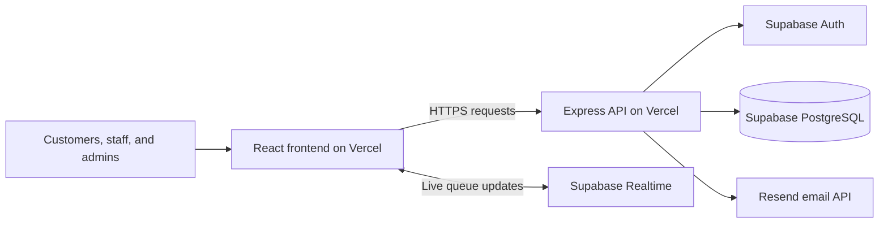
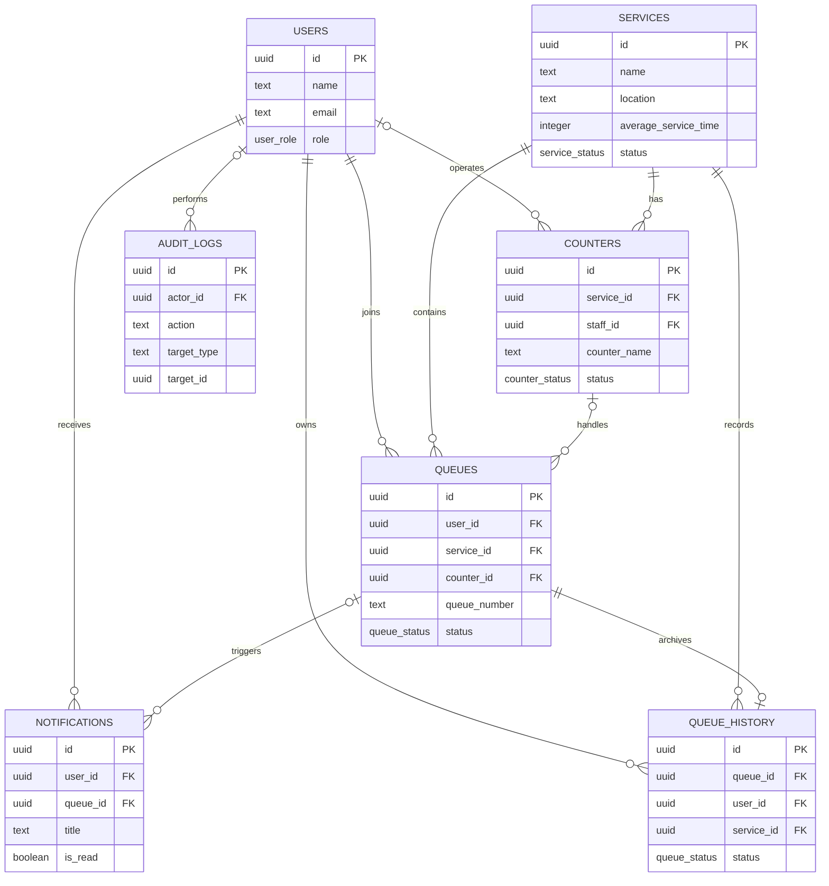

# ONEQUEUE

ONEQUEUE is a full-stack digital queue and appointment management system. Customers join service queues remotely, receive a queue number, see an explainable wait estimate, and receive status notifications. Staff manage services and move customers through `WAITING → CALLED → SERVING → COMPLETED`.

## Project overview

This project addresses physical waiting at schools, clinics, barangay offices, government offices, and other service centers. It is intentionally understandable for a college project: queue estimation is `people ahead × average service time`, while the database and authorization rules provide a solid production foundation.

## Features

- Customer registration, login, protected routes, and role-aware navigation
- Customer service browsing, queue joining, live queue tracking, cancellation, history, and notifications
- Staff dashboard with daily totals and average time calculations
- Queue actions: call, start, complete, and skip/no-show
- Service CRUD and deactivation
- Supabase PostgreSQL schema, foreign keys, trigger-based user profiles, and RLS policies
- Responsive mobile customer UI and desktop-friendly staff tables
- REST API with validation, authentication, role authorization, CORS, Helmet, and clear errors

## Structure

```text
ONEQUEUE/
├── client/                 # Vite + React customer/staff interface
│   └── src/
│       ├── components/     # Layout, protected routes, toast messages
│       ├── context/        # Authentication state
│       ├── lib/            # API and Supabase clients
│       ├── pages/          # Landing, auth, customer, and admin screens
│       └── styles.css      # Responsive visual system
├── server/                 # Express REST API
│   └── src/
│       ├── middleware/     # JWT and staff authorization
│       ├── supabase.js     # Supabase clients
│       └── index.js        # Routes and queue actions
├── supabase/schema.sql     # Tables, enums, trigger, indexes, and RLS
├── .env.example
└── package.json
```

## Technology and architecture

The React client calls the Express API using secure session cookies and CSRF protection. Express verifies sessions with Supabase Auth and uses the service-role client for controlled server-side operations. Supabase PostgreSQL stores users, services, queues, counters, notifications, and history. The browser only receives the public Supabase URL and anon key; the service-role key is server-only.

### System architecture diagram

See the separate [system architecture document](./docs/system-architecture.md) for the component and request-flow explanation.



## Database design

The schema in [`supabase/schema.sql`](./supabase/schema.sql) creates `users`, `services`, `queues`, `counters`, `notifications`, and `queue_history`. It includes foreign keys, active-queue uniqueness per customer, daily queue-number uniqueness, profile creation from Auth, and RLS policies. The `join_queue` RPC safely allocates daily queue numbers, and a unique history index prevents duplicate terminal records. Run the schema in the Supabase SQL Editor before starting the app.

### Database ERD

See the separate [database ERD document](./docs/database-erd.md) for the complete relationship summary.



## API documentation

| Method | Endpoint | Access | Purpose |
|---|---|---|---|
| POST | `/api/auth/register` | Public | Create a customer account |
| POST | `/api/auth/login` | Public | Sign in |
| GET | `/api/auth/me` | Authenticated | Load current profile |
| GET | `/api/services` | Public | List services with live waiting counts |
| POST/PUT/DELETE | `/api/services/:id` | Staff | Manage services/deactivate |
| GET | `/api/queues` | Authenticated | Own queues or all queues for staff |
| POST | `/api/queues` | Customer | Join an open service |
| PATCH | `/api/queues/:id/cancel` | Owner | Cancel own active queue |
| POST | `/api/queues/:id/call` | Staff | Mark `CALLED` |
| POST | `/api/queues/:id/start` | Staff | Mark `SERVING` |
| POST | `/api/queues/:id/complete` | Staff | Mark `COMPLETED` and archive |
| POST | `/api/queues/:id/skip` | Staff | Mark `NO-SHOW` and archive |
| GET | `/api/notifications` | Customer | List own notifications |
| PUT | `/api/notifications/:id/read` | Customer | Mark notification read |
| GET | `/api/history` | Authenticated | Filter own/all queue history |
| GET/POST | `/api/counters` | Staff | View/create counters |
| PUT/DELETE | `/api/counters/:id` | Staff | Update/deactivate counter |
| GET/POST | `/api/staff` | Admin | View/create staff accounts |
| PUT | `/api/staff/:id` | Admin | Change staff role/active status |
| GET | `/api/dashboard` | Staff | Daily statistics |

## Environment variables

Copy `.env.example` to `server/.env` and `client/.env` using the values from Supabase:

```env
# server/.env
SUPABASE_URL=https://your-project.supabase.co
SUPABASE_ANON_KEY=...
SUPABASE_SERVICE_ROLE_KEY=...
PORT=4000
CLIENT_ORIGIN=http://localhost:5173
COOKIE_DOMAIN=
COOKIE_SAME_SITE=lax
TRUST_PROXY=1
REQUIRE_STAFF_MFA=true

# client/.env
VITE_API_URL=http://localhost:4000/api
VITE_SUPABASE_URL=https://your-project.supabase.co
VITE_SUPABASE_ANON_KEY=...
```

Never commit `.env` or expose `SUPABASE_SERVICE_ROLE_KEY` to the client.

## Installation and local development

1. Create a Supabase project and run [`schema.sql`](./supabase/schema.sql). For an existing ONEQUEUE database, also run [`20261017_completion.sql`](./supabase/migrations/20261017_completion.sql) and [`20261030_security_hardening.sql`](./supabase/migrations/20261030_security_hardening.sql).
2. Copy the environment examples and fill in credentials.
3. Install dependencies from the root: `npm install`.
4. Run both applications: `npm.cmd run dev` in Windows PowerShell (`npm run dev` in other shells).
5. Open `http://localhost:5173`.

Authentication uses server-managed `HttpOnly` cookies, CSRF protection, exact-origin CORS, and automatic token refresh. Keep `CLIENT_ORIGIN` exact. In production, keep the frontend and API on the same parent domain when possible, set `COOKIE_DOMAIN` only when that parent domain must be shared, and leave `COOKIE_SAME_SITE=lax`. Cross-site deployments require `COOKIE_SAME_SITE=none` and HTTPS, but same-site custom domains are more reliable. Leave `REQUIRE_STAFF_MFA=true` so staff and administrators must enroll a TOTP authenticator before accessing operations.

To promote a user to staff for a demonstration, update the profile in Supabase SQL Editor:

```sql
update public.users set role = 'admin' where email = 'your-email@example.com';
```

## Testing and deployment

### Production URLs

- Frontend application: [https://onequeue-itp26.vercel.app](https://onequeue-itp26.vercel.app)
- Backend service: [https://onequeue-api.vercel.app](https://onequeue-api.vercel.app)
- API base URL: `https://onequeue-api.vercel.app/api`
- API health check: [https://onequeue-api.vercel.app/api/health](https://onequeue-api.vercel.app/api/health)

The production frontend uses `VITE_API_URL=https://onequeue-api.vercel.app/api`. The API exposes `GET /api/health` for a basic deployment check. Run the server unit checks with `npm test --workspace server` and build the client with `npm run build` before deployment.

## Security notes

The server verifies Supabase access tokens, separates customer/staff access, scopes customer queue reads to the authenticated user, validates required registration fields, and uses database RLS. For production, add rate limiting, stronger request schemas for every mutation, email confirmation policy, audit logging, and a transaction/RPC for high-concurrency queue-number generation.

## External notification integration

ONEQUEUE stores every notification in Supabase first. If `RESEND_API_KEY` and `NOTIFICATION_FROM` are configured on the server, the same event is also sent through Resend. External delivery is best-effort and never blocks queue creation or queue state changes. Without those variables, the in-app notification remains available and the API reports no external delivery attempt.

## Profile and recovery

Customers can update their display name from the Profile page and request a Supabase password reset from `/forgot-password`. Configure the Supabase Auth redirect URL to include the deployed frontend URL and `/reset-password` before enabling recovery links in production.

## Future improvements

The current release includes counter and staff administration APIs/UI, customer dashboard and service browsing, live queue tracking, notifications, queue history filtering, and a concurrency-safe `join_queue` PostgreSQL RPC. Future improvements include richer date-range reports, counter-to-active-queue assignment, SMS/email notifications, and automated end-to-end browser tests.

## GitHub workflow and team contributions

Use feature branches such as `feature/customer-queue` and pull requests into `main`. Keep commits focused, review schema/API changes together, and record each team member's contribution in the project report.
