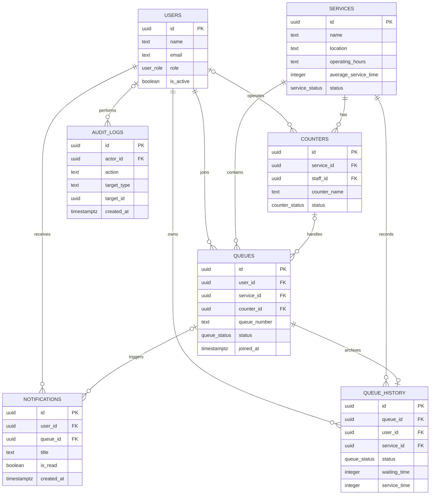

# ONEQUEUE Database ERD

The database stores accounts, services, counters, active queues, notifications, completed queue history, and security audit records.

## Main Relationships

- A user can join many queues and receive many notifications.
- A service can have many counters and queues.
- A counter may be assigned to a staff member and can handle many queues.
- A completed or ended queue has at most one queue-history record.
- Privileged staff and administrator actions are recorded in the audit log.

