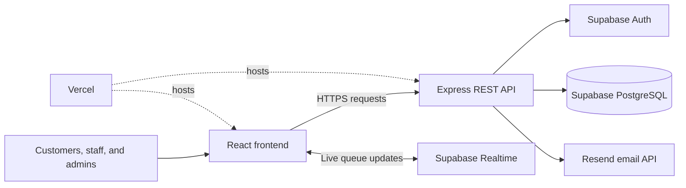

# ONEQUEUE System Architecture

ONEQUEUE uses a three-tier web architecture. The React frontend provides the customer, staff, and administrator interfaces. The Express API handles authentication, validation, authorization, and queue operations. Supabase provides authentication, PostgreSQL storage, and real-time updates.

## Request Flow

1. The user opens the React application hosted on Vercel.
2. The frontend sends authenticated requests to the Express API using secure cookies and CSRF protection.
3. Express validates the request and checks the user's customer, staff, or administrator role.
4. The API reads or updates data in Supabase PostgreSQL.
5. Supabase Realtime and in-app notifications keep queue information current.
6. Resend can deliver optional email notifications without blocking queue operations.

